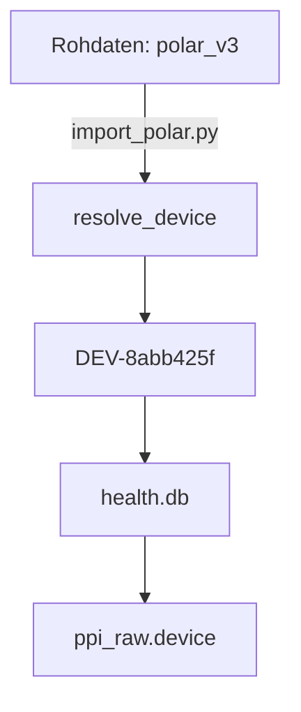
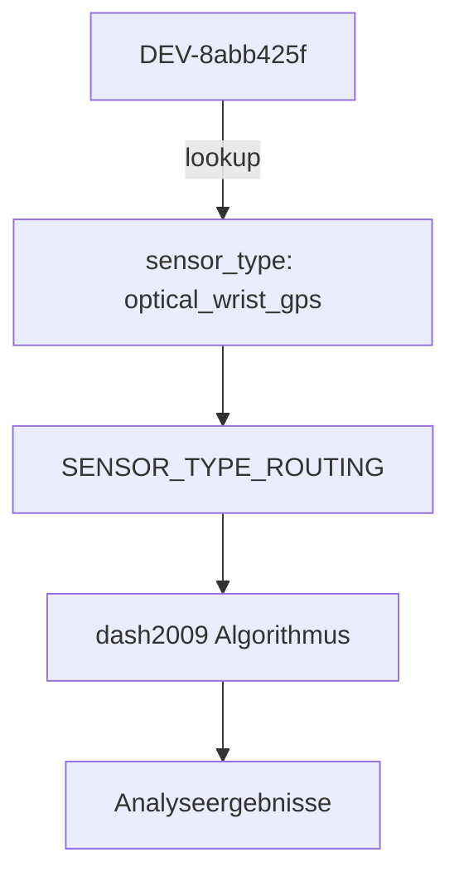

# Kyoro-HealthHub Datenschutz-Architektur

> **English Version:** [PRIVACY_ARCHITECTURE.md](PRIVACY_ARCHITECTURE.md)

## Kernprinzip des Datenschutzes

**"Keine lesbaren Gerätemodelle oder Personen-/Beziehungs-Identifikatoren verlassen die lokale Konfiguration — nicht einmal in health.db oder medicine.db"**

Dieses Prinzip erweitert die bestehende Pseudonymisierung von Seriennummern in Kyoro-HealthHub auf alle lokal identifizierbaren Werte und stellt sicher, dass:

1. **Speicherung**: Nur undurchsichtige Pseudonyme in Datenbanken gespeichert werden
2. **Auflösung**: Lokale Abbildung über das `identity_resolver`-Modul
3. **Anzeige**: Just-in-Time-Auflösung für menschenlesbare Berichte
4. **Weiterleitung**: Semantische Operationen verwenden abstrakte Eigenschaften (sensor_type), keine Identifikatoren

## Implementierungsebenen

### 1. Identity-Resolver-Modul (`scripts/modules/identity_resolver.py`)

**Zentralisierte Pseudonym-Verwaltung**

```python
from modules.identity_resolver import resolve_device, resolve_person, reverse_resolve

# Vorwärtsauflösung (real → Pseudonym)
dev_pseudo = resolve_device("polar_v3")  # "DEV-8abb425f"
person_pseudo = resolve_person("self")   # "PER-6173fec1"

# Rückwärtsauflösung (Pseudonym → real)
real_device = reverse_resolve(dev_pseudo)  # "polar_v3"

# Menschenlesbare Anzeigenamen für Berichte
display_name = resolve_display_name(dev_pseudo)  # "polar_v3 (optical_wrist_gps)"
```

**Eigenschaften**:
- **Deterministisch**: Salz-basierter SHA-256-Hash, gleiche Eingabe (mit demselben lokalen Salz) → gleiche Ausgabe
- **Gesalzen**: Jeder Hash wird mit einem zufälligen, einmal generierten Salz kombiniert, das in der Tabelle `pseudonym_salt` in `identity.db` gespeichert wird (niemals in `health.db`/`medicine.db`/dem Repository) — ohne dieses Salz wären die niedrig-kardinalen echten Werte (einige Dutzend bekannte Gerätemodell-Strings, `'self'`/`'partner'`) durch jeden mit Datenbankzugriff angreifbar, einfach durch Hashen aller bekannten Kandidaten und Vergleich
- **Lokal**: Kein Netzwerkzugriff, alle Daten in `~/.config/kyoro/identity.db`
- **Idempotent**: Sicheres erneutes Ausführen, bestehende Pseudonyme bleiben erhalten (das Salz wird einmal generiert und ändert sich nie, sodass ein gegebener echter Wert immer in dasselbe Pseudonym aufgelöst wird)
- **Umkehrbar**: Lokale Administratoren können über `identity.db` prüfen

### 2. Datenbankschema

**Nur Pseudonyme in der Speicherung**

```sql
-- health.db und medicine.db enthalten NUR Pseudonyme
CREATE TABLE devices (
    device_id TEXT PRIMARY KEY,  -- "DEV-8abb425f", nie "polar_v3"
    person TEXT,                -- "PER-6173fec1", nie "self"
    -- ... andere Spalten
);

CREATE TABLE measurements (
    device_id TEXT,             -- "DEV-8abb425f"
    person TEXT,                -- "PER-6173fec1"
    -- ... andere Spalten
);
```

**Identitätsdatenbank** (`~/.config/kyoro/identity.db`):
```sql
-- Echte ↔ Pseudonym-Abbildungen (nur lokal, nie im Repository)
CREATE TABLE device_id_map (
    pseudo_id TEXT PRIMARY KEY,  -- "DEV-8abb425f"
    device_id_real TEXT,         -- "polar_v3"
    created_at TIMESTAMP
);

CREATE TABLE person_map (
    pseudo_id TEXT PRIMARY KEY,  -- "PER-6173fec1"
    person_real TEXT,            -- "self"
    created_at TIMESTAMP
);

-- Einzeilige Tabelle, die das lokale geheime Salz speichert, das in jeden
-- Pseudonym-Hash eingemischt wird (siehe "Identity-Resolver-Modul" oben).
-- Wird einmal mit `secrets.token_hex(32)` bei der ersten Verwendung generiert
-- und nie irgendwo außerhalb dieser Datenbank geschrieben.
CREATE TABLE pseudonym_salt (
    id INTEGER PRIMARY KEY CHECK (id = 1),
    salt_hex TEXT NOT NULL
);
```

### 3. Semantische Weiterleitung über Sensortypen

**Abstrakte Geräteeigenschaften, keine Identifikatoren**

```python
# compute_arrhythmia.py
SENSOR_TYPE_ROUTING = {
    'chest_strap':        'tateno_glass',    # Polar H7/H10
    'optical_wrist_gps':  'dash2009',        # Polar V3, Garmin Fenix
    'ring':               'sampentropy',      # Oura Ring
    'smartphone':         'sampentropy',      # Kamera-PPG
}

# Auflösungsablauf:
# 1. device_id aus Datenbank holen (Pseudonym: "DEV-8abb425f")
# 2. sensor_type aus Registry abrufen: "optical_wrist_gps"
# 3. Über sensor_type weiterleiten: "dash2009"
# 4. Niemals Pseudonym-Strings direkt vergleichen
```

### 4. Menschenlesbare Berichte

**Just-in-Time-Auflösung für die Anzeige**

```python
# analyse_ecg_session.py
device_display = resolve_display_name(device_id)  # "polar_v3 (optical_wrist_gps)"

print(f"Gerät: {device_display}")  # Menschenlesbar im Bericht
print(f"Algorithmus: {algorithm}")    # Basierend auf sensor_type

# Datenbank enthält immer noch: "DEV-8abb425f"
# Bericht zeigt: "polar_v3 (optical_wrist_gps)"
```

## Datenfluss-Beispiele

### Import-Fluss (Pseudonymisierung)



### Analyse-Fluss (Auflösung)

```mermaid
graph TD
    A[health.db] -->|DEV-8abb425f| B[compute_arrhythmia.py]
    B --> C[resolve_display_name]
    C --> D[polar_v3 (optical_wrist_gps)]
    D --> E[Bericht/Analyse-Ausgabe]
```

### Weiterleitungs-Fluss (Abstraktion)



## Datenschutz-Garantien

### ✅ Speicher-Datenschutz
- **Keine semantischen Identifikatoren** in `health.db` oder `medicine.db`
- **Keine semantischen Identifikatoren** im Git-Repository
- **Keine semantischen Identifikatoren** in Backups (nach Migration)

### ✅ Verarbeitungs-Datenschutz
- **Alle Auflösungen erfolgen lokal** (keine Netzwerkanfragen)
- **Deterministische Pseudonyme** (kein Tracking über Instanzen hinweg)
- **Kein Round-Tripping** (echte Namen werden nie in Datenbanken gespeichert)

### ✅ Berichts-Datenschutz
- **Berichte zeigen menschenlesbare Namen** (für Benutzerfreundlichkeit)
- **Datenbanken speichern nur Pseudonyme** (für Datenschutz)
- **Auflösung erfolgt zur Anzeigezeit** (nicht zur Speicherzeit)

### ✅ Prüfbarkeit
- **Lokale Administratoren können** Pseudonyme über `identity.db` rückverfolgen
- **Migrationsskripte enthalten Dry-Run**-Modus zur Überprüfung
- **Zeilenanzahlen werden** vor/nach Migration überprüft

## Geltungsbereich und Einschränkungen

### Im Geltungsbereich ✅
- `device_id`-Werte in allen Tabellen (devices, measurements, ppi_raw, usw.)
- `person`-Werte in allen Tabellen (self, partner, usw.)
- `device`-Spalte in der ppi_raw-Tabelle
- Anzeigenamen-Auflösung für Berichte
- Sensortyp-basierte Algorithmus-Weiterleitung

### Außerhalb des Geltungsbereichs ❌
- Quellen-App-Namen (polar_connect, apple_health, usw.) — dies sind keine Identifikatoren
- Klinischer Textinhalt in medicine.db — durch separate Datenschutzmaßnahmen abgedeckt
- Backup-Dateien und Git-Verlauf — historische Daten werden nicht geändert
- Externe System-Identifikatoren — werden durch die Datenschutzrichtlinien dieser Systeme behandelt

### Bekannte Einschränkungen
- **Legacy-Daten**: Alte Backups vor der Migration enthalten noch semantische Identifikatoren — historische Daten werden nicht geändert (siehe "Außerhalb des Geltungsbereichs" oben)
- **Geräte-ID-Abgleich über Quellen hinweg**: Ein physisches Gerät kann in verschiedenen Quellen unter unterschiedlichen echten Werten erscheinen (ein `SN-` Serien-Pseudonym, eine rohe Hex-Seriennummer, ein semantischer Name wie `polar_ignite2`). `identity_resolver._canonicalize_device()` normalisiert bekannte Schreibweisen über `device_serial_map` vor dem Hashen, aber dies hängt davon ab, dass diese Tabelle die Abbildung bereits kennt — eine wirklich neue Schreibweise, die noch nicht registriert wurde, würde immer noch in ein eigenes, separates `DEV-XXXXXXXX`-Pseudonym gehasht, anstatt als dasselbe Gerät erkannt zu werden. Dies ist ein echtes, noch offenes Folgeproblem, kein Migrationsfehler.
- **Rohaufrufe von `sqlite3.connect()`**: Produktions-Importer und Compute-Skripte gehen über `modules/db.py`'s `open_db()`/`open_medicine_db()`, die den Pseudonymisierungs-Sicherungs-Trigger und SQL-Funktionen pro Verbindung installieren. Jedes Skript, das die Datenbank stattdessen mit `sqlite3.connect()` direkt öffnet, würde beim Schreiben mit `no such function: pseudonymize_person` abstürzen (oder Klartest ohne den Trigger schreiben). Die Produktions-Pipeline ist abgedeckt; Test-/Utility-Skripte außerhalb dieses Pfades wurden nicht erschöpfend auf dies überprüft.

## Compliance-Checkliste

### Speicherebene
- [x] `health.db` verwendet nur Pseudonyme
- [x] `medicine.db` verwendet nur Pseudonyme
- [x] `identity.db` speichert lokale real↔Pseudonym-Abbildungen
- [x] Keine semantischen Identifikatoren in Datenbankschemas

### Verarbeitungsebene
- [x] Alle device_id-Abfragen gehen durch `identity_resolver`
- [x] Alle person-Abfragen gehen durch `identity_resolver`
- [x] Algorithmus-Weiterleitung verwendet `sensor_type`, keine device_id-Strings
- [x] Keine direkten `device_id == "polar_v3"`-Vergleiche im Code

### Berichtsebene
- [x] Berichte verwenden `resolve_display_name()` für menschenlesbare Ausgabe
- [x] Datenbankabfragen verwenden Pseudonyme
- [x] Anzeigeauflösung erfolgt zur Render-Zeit
- [x] Fallback-Mechanismen für fehlende Abbildungen

### Dokumentation
- [x] Code-Docstrings aktualisiert
- [x] Benutzerdokumentation generiert
- [x] Migrationsskripte dokumentiert
- [x] Datenschutz-Architektur dokumentiert (diese Datei)

## Migrationsprozedur (Historische Referenz — Bereits ausgeführt)

Die folgende Migration wurde bereits gegen die echten `health.db` und
`medicine.db` ausgeführt (siehe `openspec/changes/archive/pseudonymize-device-person-identifiers/`
für den vollständigen Bericht: alle Tabellen commited, 0 Fehler, 0 Datenverlust).
Sie wird hier als Referenz für das Aussehen der einmaligen Migration beibehalten —
z. B. wenn eine frische Installation später von einem alten, vor der Pseudonymisierung
erstellten Backup migriert wird.

```bash
# 1. Datenbanken sichern
cp data/health.db data/health.db.bak.$(date +%Y-%m-%d)
cp data/medicine.db data/medicine.db.bak.$(date +%Y-%m-%d)

# 2. Pseudonyme für bestehende Daten generieren
python3 scripts/migrations/generate_pseudonyms_for_existing_data.py

# 3. Migration testen (Dry-Run)
python3 scripts/migrations/pseudonymize_device_person_identifiers.py --dry-run

# 4. Migration ausführen
python3 scripts/migrations/pseudonymize_device_person_identifiers.py --execute

# 5. Registry aktualisieren
python3 scripts/migrations/update_registry_with_pseudonyms.py --execute

# 6. Ergebnisse überprüfen
python3 tools/qa_check.py
sqlite3 data/health.db "SELECT DISTINCT device_id FROM devices;"

# 7. Berichte testen
python3 scripts/analysis/manual/analyse_ecg_session.py
```

## Überprüfungsbefehle

```bash
# Überprüfen, ob Pseudonyme verwendet werden
sqlite3 data/health.db "SELECT device_id FROM devices LIMIT 5;"
# Sollte zeigen: DEV-XXXXXXXX Format

# Identitätsabbildungen überprüfen
sqlite3 ~/.config/kyoro/identity.db "SELECT * FROM device_id_map LIMIT 5;"
# Sollte zeigen: real→Pseudonym-Abbildungen

# Auflösung testen
python3 -c "from modules.identity_resolver import resolve_display_name; print(resolve_display_name('DEV-8abb425f'))"
# Sollte zeigen: "polar_v3 (optical_wrist_gps)"

# OWN_PERSON_ID testen
python3 -c "from health_config import OWN_PERSON_ID; print(OWN_PERSON_ID)"
# Sollte zeigen: PER-XXXXXXXX Format
```

## Ortsdaten

Orte, die Importer finden, werden über `location_store.record()` in einer
eigenen Datenbank gespeichert, `location.db`, mit der Genauigkeit, die in
`~/.config/kyoro/location_privacy.json` je Importer und Dateityp eingestellt
ist. Importer ohne Eintrag speichern nichts. Orte für externe KI-Anbieter
werden über eine Freigabeliste je aufrufendem Skript gefiltert (Standard:
keine), Bilder werden vor dem Senden ohne Metadaten neu kodiert, und
Exporte lassen Ortsspalten weg, außer das Profil ist freigegeben.
Sport-Tracks, Aufenthalte und Standortverlauf sind ebenfalls Tabellen in
`location.db`; `health.db` und `medicine.db` enthalten keine persönlichen
Koordinaten (geprüft mit `scripts/utils/check_location_columns.py`).
Details:
[PII_Anonymization_DE.md](PII_Anonymization_DE.md), Abschnitt 5c.

## Externe Dienste

Kyoro-HealthHub fragt externe Dienste für Umweltdaten ab (Wetter, Luftqualität, Pollen).
Alle an externe Dienste gesendeten Koordinaten werden über `for_external_api()` in
`location_privacy.json` vergröbert, um die Privatsphäre zu schützen. Die Standardgenauigkeit
beträgt 1 Dezimalstelle (~11 km Raster), mit 2 Dezimalstellen (~1 km) nur für die
Rückwärtsgeokodierung von Ortsnamen.

| Dienst | Zweck | Was er erhält | API-Schlüssel erforderlich | Einstellung |
|--------|-------|---------------|-----------------------------|-------------|
| Open-Meteo | Wetter, Luftqualität, UV-Index, Geokodierung | Vergröberte Koordinaten (Standard 1 Dezimalstelle) | Nein | `external_api.precision` |
| Bright Sky | DWD-Wetterstationsdaten | Vergröberte Koordinaten (Standard 1 Dezimalstelle) | Nein | `external_api.precision` |
| DWD-Pollen | Pollendaten (Datei-Download) | Nichts (regionenbasierter Download) | Nein | `environment.dwd_pollen_region` |
| Google Pollen | Pollendaten (Opt-in) | Vergröberte Koordinaten (Standard 1 Dezimalstelle) | Ja | `external_api.services.google_pollen` |
| AEMET | Spanische Wetterdaten | Nur eine Stations-ID (die nächste Station wird lokal aus der geladenen Stationsliste bestimmt) | Ja | `apis.aemet_api_key` in `health_config.json` |
| Nominatim (OpenStreetMap) | Ortsnamenssuche | Vergröberte Koordinaten (2 Dezimalstellen für Ortsnamen, 1 für Region); bei manuellen Reiseeinträgen ohne Koordinaten der eingetragene Ortsname (Stadt oder Subregion, mit Land) | Nein | `external_api.precision`, `external_api.place_precision` |

**Opt-in-Dienste**: Google Pollen erfordert eine explizite Freigabe über
`external_api.services.google_pollen: true` in `location_privacy.json`.
Ohne diese Einstellung werden keine Standortdaten an Google gesendet.

**Regionenbasierte Dienste**: DWD-Pollen verwendet Regions-IDs vom Deutschen Wetterdienst
und überträgt keine Koordinaten. Die Region kann über `environment.dwd_pollen_region`
in `health_config.json` konfiguriert oder aus den Heimatkoordinaten mit einer Warnung
geschätzt werden.

## Zukünftige Erweiterungen

Das `identity_resolver`-Modul ist als **generisches Pseudonym-Registry** konzipiert und kann
erweitert werden, um zusätzliche Identifikatortypen zu behandeln:

```python
# Zukünftige Erweiterungen
resolve_home_assistant_instance("homeassistant_main")  # "HA-XXXXXXXX"
resolve_weather_station("ecowitt_outdoor")         # "WS-XXXXXXXX"
resolve_location("home_gps_coordinates")           # "LOC-XXXXXXXX"
```

Dies ermöglicht es Kyoro-HealthHub, das Datenschutzprinzip beizubehalten, wenn neue
Gerätetypen und Identifikatoren zum System hinzugefügt werden.

## Referenzen

- **OpenSpec-Änderung**: `openspec/changes/archive/pseudonymize-device-person-identifiers/`
- **Design-Dokument**: `openspec/changes/archive/pseudonymize-device-person-identifiers/design.md`
- **Implementierungszusammenfassung**: Lokale Migrationszusammenfassung (nicht Teil dieses Repositorys)
- **Identity-Resolver-API**: `docs/en/modules/identity_resolver.md`
- **Migrationsskripte**: `scripts/migrations/pseudonymize_device_person_identifiers.py`

## Anhang: Pseudonym-Formatspezifikation

### Geräte- und Personen-Identifikatoren (gesalzen, über `identity_resolver`)
- **Hash**: Erste 8 Zeichen von SHA-256(`f"{local_salt}:{kind}:{real_value}"`), wobei `kind` `"device"` oder `"person"` ist und `local_salt` das 32-Byte-Hex-Geheimnis aus der Tabelle `pseudonym_salt` in `~/.config/kyoro/identity.db` ist (einmal generiert über `secrets.token_hex(32)`, nie commited oder übertragen)
- Ohne das Salz könnte ein Angreifer mit Datenbankzugriff das Pseudonym brechen, indem er jeden bekannten Kandidaten-Gerätemodell-String oder `person`-Wert hasht und vergleicht — das Salz ist das, was diesen Wörterbuchangriff unmöglich macht

### Geräte-Identifikatoren
- **Präfix**: `DEV-`
- **Beispiel**: `DEV-8abb425f`
- **Regex**: `^DEV-[0-9a-f]{8}$`

### Personen-Identifikatoren
- **Präfix**: `PER-`
- **Beispiel**: `PER-6173fec1`
- **Regex**: `^PER-[0-9a-f]{8}$`

### Seriennummern (Bestehend, ungesalzen)
- **Präfix**: `SN-`
- **Hash**: Erste 8 Zeichen von SHA-256(`real_serial`) (`scripts/utils/anonymize.py`) — dies stammt aus der Zeit vor `identity_resolver` und ist nicht gesalzen; Seriennummern haben eine viel höhere Kardinalität als `device_id`/`person`, sodass das Wörterbuchangriffsrisiko, das die Salzung der DEV-/PER-Pseudonyme motiviert hat, hier nicht in gleichem Maße gilt
- **Beispiel**: `SN-4a8fd0b9`
- **Regex**: `^SN-[0-9a-f]{8}$`

### Konten-Identifikatoren (Bestehend, ungesalzen)
- **Präfix**: `ACC-`
- **Beispiel**: `ACC-1d9ef68b`
- **Regex**: `^ACC-[0-9a-f]{8}$`

Alle Pseudonyme sind **deterministisch** (gleiche Eingabe → gleiche Ausgabe) und **lokal umkehrbar** (über `identity.db`).
